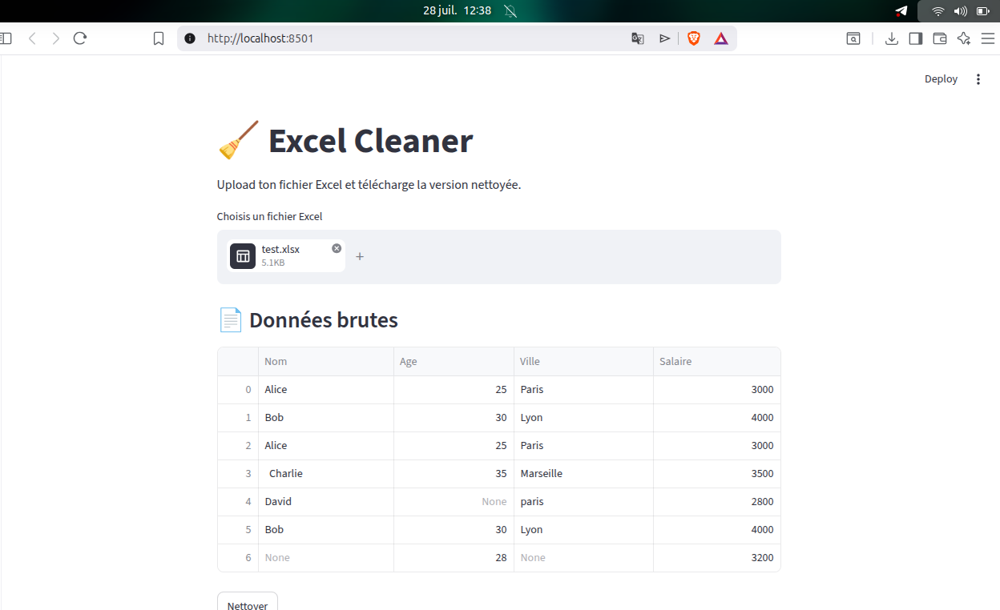
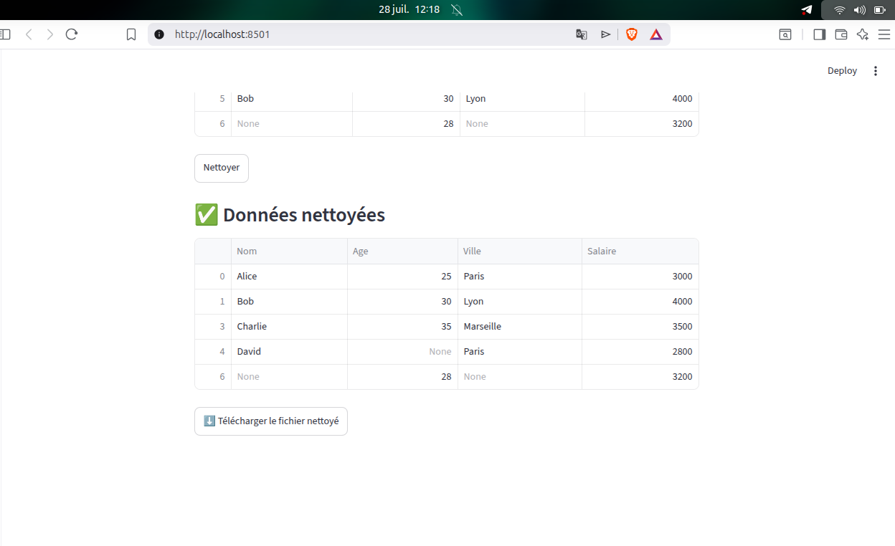

# 🧹 Excel Cleaner

A Python-based Excel file cleaning tool with an interactive web interface built with Streamlit.

## 📸 Screenshots

**Raw data uploaded**


**Cleaned data ready to download**


---

## ✨ Features

- ✅ Remove empty rows
- ✅ Remove empty columns
- ✅ Remove duplicate rows
- ✅ Strip extra whitespace from text cells
- ✅ Normalize text casing (capitalize first letter)
- ✅ Intuitive web interface via Streamlit
- ✅ One-click download of the cleaned file

---

## 🗂️ Project Structure

```
excel-cleaner/
│
├── README.md
├── requirements.txt
├── .gitignore
├── app.py                  # Streamlit entry point (web interface)
│
├── excel_cleaner/
│   ├── __init__.py
│   ├── main.py             # Terminal entry point
│   ├── cleaner.py          # Cleaning orchestrator
│   ├── loader.py           # Excel file loader
│   ├── exporter.py         # Cleaned file exporter
│   ├── report.py           # Report generator
│   │
│   └── cleaning/
│       ├── __init__.py
│       ├── duplicates.py
│       ├── empty_rows.py
│       ├── empty_columns.py
│       ├── spaces.py
│       └── casing.py
│
└── tests/
    ├── __init__.py
    ├── test_duplicates.py
    ├── test_spaces.py
    └── test_cleaner.py
```

---

## 🚀 Getting Started

### Prerequisites

- Python 3.10+
- pip

### Installation

```bash
# Clone the repository
git clone https://github.com/selom-sagbo/excel-cleaner.git
cd excel-cleaner

# Create a virtual environment
python3 -m venv .venv
source .venv/bin/activate  # Linux/Mac
# or
.venv\Scripts\activate     # Windows

# Install dependencies
pip install -r requirements.txt
```

---

## 💻 Usage

### Web Interface (recommended)

```bash
streamlit run app.py
```

Opens automatically at `http://localhost:8501`.

1. Upload your Excel file
2. Click **Nettoyer** (Clean)
3. Download the cleaned file

### Terminal

```bash
# Place your file in data/input/
python3 -m excel_cleaner.main
# Cleaned file will be saved in data/output/
```

---

## 🛠️ Tech Stack

| Tool | Usage |
|---|---|
| Python 3.10+ | Core language |
| pandas | Data manipulation and cleaning |
| openpyxl | Excel file reading/writing |
| Streamlit | Web interface |

---

## 👤 Author

**Selom SAGBO**
- GitHub : [@selom-sagbo](https://github.com/selom-sagbo)

---

## 📄 License

MIT
